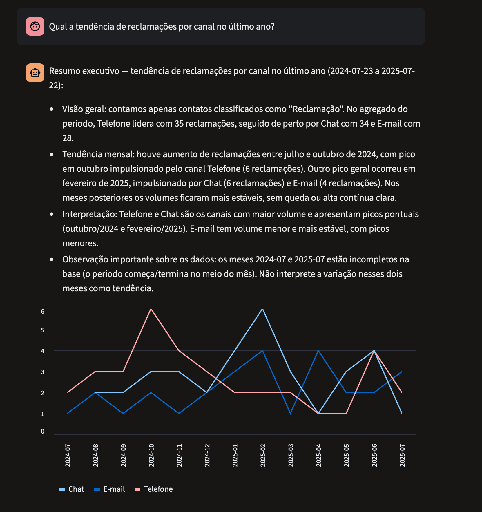
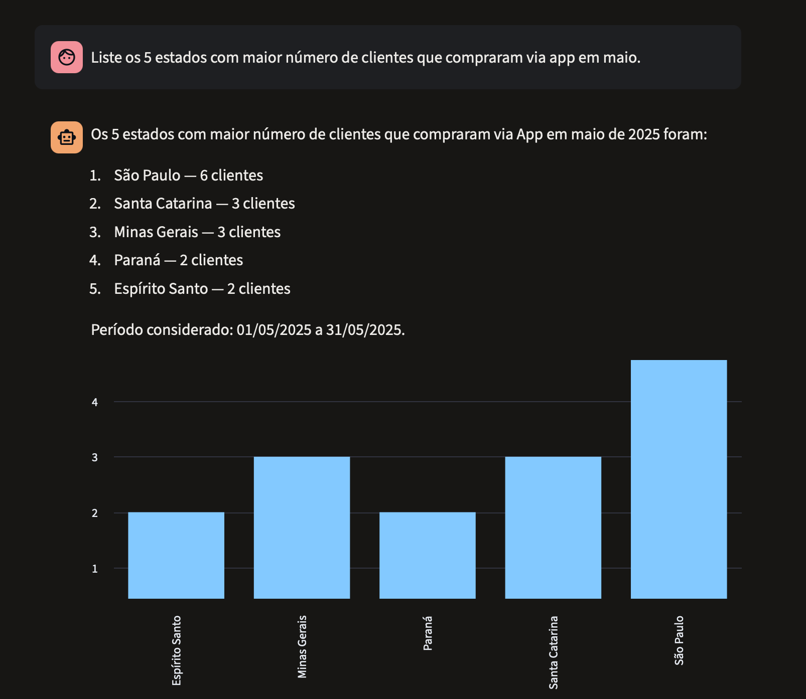
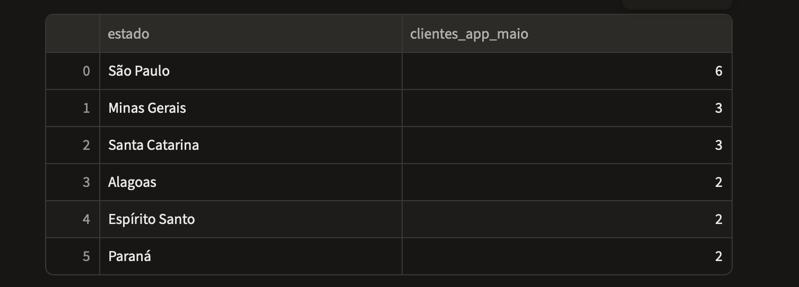
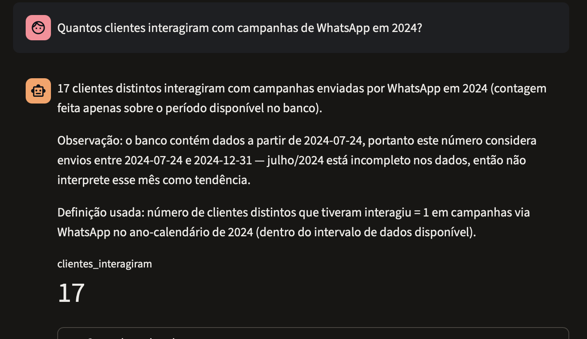
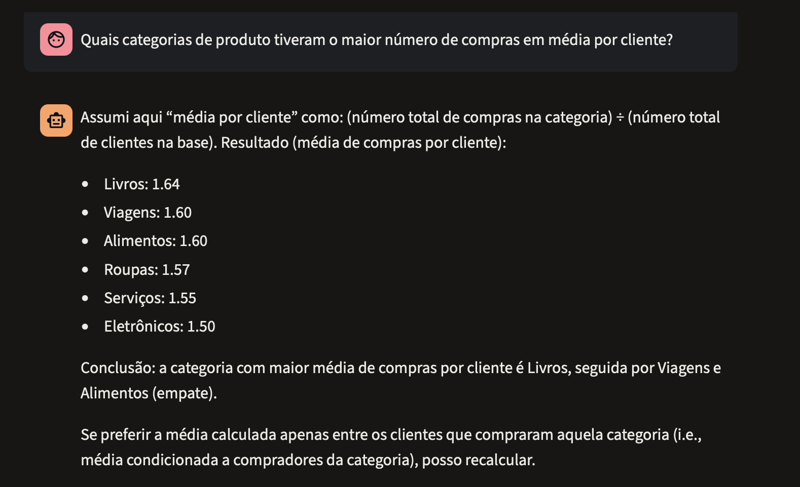
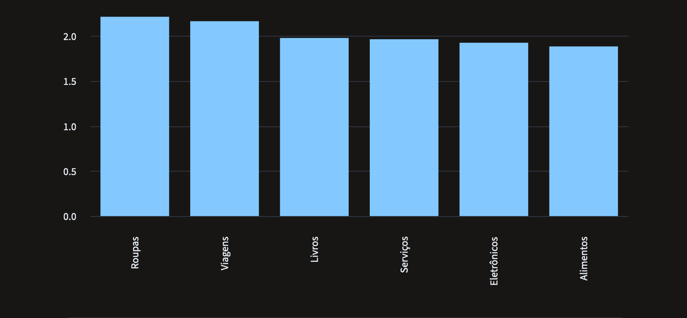
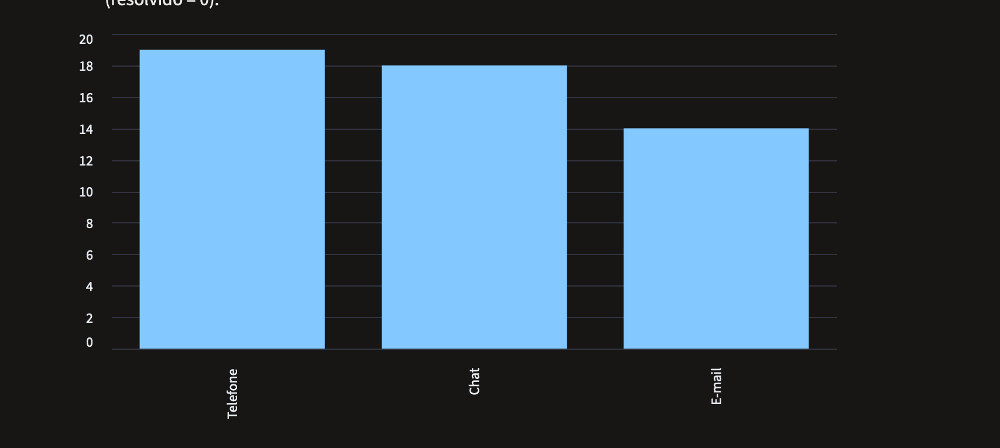
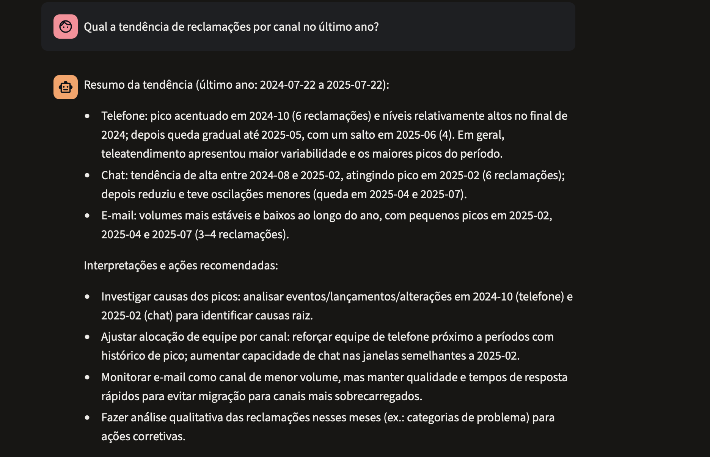
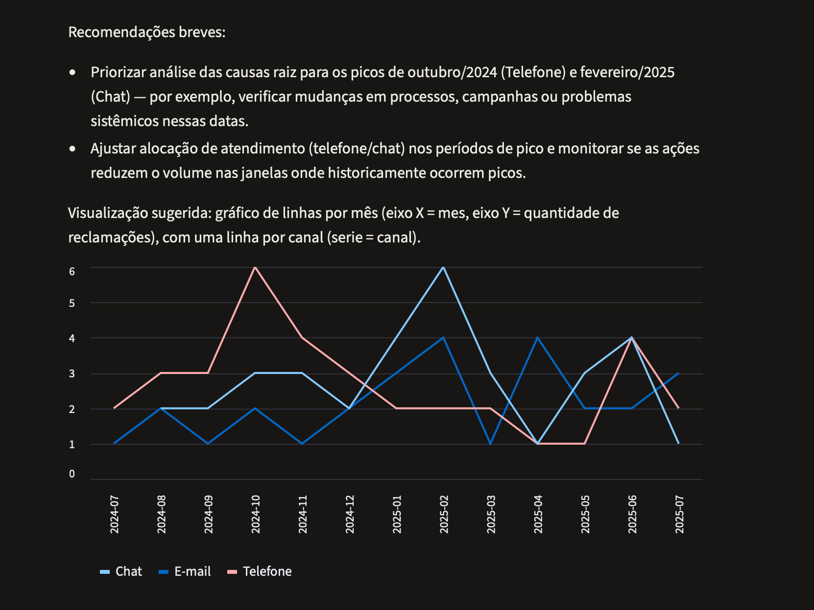

# Franq SQL Agent

A "virtual data analyst" for the Franq hiring challenge (Desafio Técnico 1). A director
asks a business question in Portuguese; an LLM agent investigates a SQLite database with
as many read-only SQL queries as it needs, fixes its own SQL errors, and answers with
text plus a table, bar chart, line chart or single number. Every query it ran is shown
under "Como cheguei aqui". Built with LangGraph, OpenAI (`gpt-5-mini`) and Streamlit.



*Question 5 in the app (current version). Two parts between the summary and the chart
are cropped out of this image: the recommendations and a line naming the chart's columns
(`serie = canal`). The full answer is in [the screenshots below](#screenshots).*

**Results.** On the 5 example questions from the challenge, run 3 times each, all 15
runs returned the same data as a hand-written reference query (eval round 4). The answer
text is less reliable: 4 of the 15 texts still mention column names or SQL. Details and
caveats in [Tested examples](#tested-examples) and [docs/EVALS.md](docs/EVALS.md).

## How to run

Requirements: an OpenAI API key and the challenge database. The challenge calls the file
both `anexo_desafio_1.db` and `clientes_completo.db`; put it at
`data/anexo_desafio_1.db` (it is not in git), then:

```bash
cp .env.example .env          # then set OPENAI_API_KEY in .env
# optional: LLM_MODEL in .env (default: gpt-5-mini)
```

With [uv](https://docs.astral.sh/uv/) (recommended; installs Python 3.11 if needed and
the exact versions in `uv.lock`):

```bash
uv sync
uv run streamlit run app.py   # chat UI; the sidebar has the 5 example questions
uv run pytest                 # tests use a fake LLM: no API key needed
uv run ruff check .           # lint
```

With pip (needs Python 3.11; `requirements.txt` pins the direct dependencies):

```bash
python3.11 -m venv .venv && source .venv/bin/activate
pip install -r requirements.txt
streamlit run app.py
```

Tests that need the database skip if it is missing.

## Agent flow and architecture

```
START --> agent <---> tools
            |
            +--> END
```

- `agent`: the LLM, with two tools bound, reads the conversation and calls either
  `run_sql` (run one query, get rows or the error) or `final_answer` (answer text, final
  SQL, chart type, x/y columns and an optional `serie` column). It must call exactly one
  tool per turn (`tool_choice="required"`, `parallel_tool_calls=False`).
- `tools`: runs the query through the safe executor (`src/db.py`), records the step
  (SQL, row count or error) and sends the result back, so the agent can fix its SQL.
- The graph ends at `final_answer` or after 8 turns. The app then re-runs the final SQL
  and draws the table or chart from that result.

### Why this design

- **One agent with two tools, not several agents.** The job is one skill: explore a
  database with SQL until the question is answered. A planner/SQL-writer/critic split
  would add LLM calls, latency and hand-off failures without a clear gain at this size.
  Self-correction comes from feeding the real SQL error back to the same agent.
- **The final answer is a tool call, not free text.** It returns structured fields
  (SQL, chart type, columns) that code can validate, instead of parsing prose.
- **Table and chart numbers come from the database, not from the LLM.** Code re-runs the
  final SQL and draws the table or chart from that result. The answer text, including any
  numbers in it, is written by the LLM.
- **Safety lives in the database layer, not in the prompt.** Whatever the user or the
  model writes, the connection can only read, cannot read personal columns, and is
  bounded in time and size.
- **LangGraph** makes the loop explicit: state (the steps), turn limits and the stop
  condition are code, and the whole graph is tested with a fake LLM.

Code layout:

| File | Role |
| --- | --- |
| `src/schema.py` | Reads the schema, value lists for low-cardinality columns and date ranges |
| `src/prompts.py` | Builds the system prompt (in Portuguese) from the schema |
| `src/db.py` | Safe query execution (`run_query`) and CSV text for the LLM |
| `src/agent.py` | The LangGraph agent and `ask()` |
| `src/viz.py` | Validates the LLM's chart choice against the real data |
| `src/llm.py` | OpenAI model factory (`OPENAI_API_KEY`, `LLM_MODEL`) |
| `src/evaluation.py` | Compares the agent's final data with a reference result |
| `app.py` | Streamlit chat interface |
| `scripts/run_examples.py` | Runs the 5 example questions and checks them against reference SQL |

**Language.** Users, prompts, tool descriptions, UI and answers are in Portuguese,
matching the users and the data values (`'Reclamação'`, `'Telefone'`). README,
docstrings and commits are in English; many identifiers are Portuguese domain words
(`passos`, `pergunta`, `caminho`).

## Design decisions

- **Read-only database access.** Queries run on a connection opened with SQLite
  `mode=ro`, with an authorizer that only allows `SELECT`, `READ`, `FUNCTION` and
  `RECURSIVE` (for `WITH RECURSIVE`), and a check that only one statement is sent.
- **Personal data is blocked by the database.** The schema given to the LLM never
  samples `clientes.nome` or `clientes.email`, and the authorizer denies reading those
  two columns, so no query can return them (`SELECT *` on `clientes` fails with a
  message asking for the columns it needs).
- **Bounded queries.** Each query stops after 10 s and 10,000 rows; each text or blob
  value is limited to 1 MB and a whole result to 20 MB (rows are read one at a time), so
  a query such as `SELECT randomblob(...)` cannot exhaust memory. The LLM sees at most
  200 rows and 20,000 characters per result, with a note when something was cut.
- **Bounded loops with a polite fallback.** At most 8 agent turns, plus a LangGraph
  recursion limit as a safety net; each OpenAI request has a 60 s timeout and 2 retries.
  If the agent cannot finish, the user gets "Não consegui concluir a análise.", the
  last SQL error and the steps already run.
- **Relative periods use the data, not today's date.** The data spans 2024-07-22 to
  2025-07-22; the prompt says "último ano" counts back from 2025-07-22 and names the
  partial first and last months, so a short month is not read as a trend.
- **Business rules in the prompt.** "Average per customer" in a category is purchases
  divided by that category's distinct buyers; a complaint is a support contact of type
  `Reclamação`; a top-N cut inside a tie lists every tied item; the answer text should
  use business language (the SQL is already shown under "Como cheguei aqui").
- **Chart choice is validated.** `src/viz.py` checks the LLM's choice against the data
  (x and y exist and differ, y is numeric, more than one row) and falls back to a table;
  a 1x1 result is shown as a number. Trends per category use long-format data and a
  `serie` column, pivoted into one line or bar per category. Bars keep the SQL row
  order, so a ranking stays a ranking; lines are sorted by x.

## Tested examples

The 5 example questions from the challenge are in the app's sidebar. Each has a
hand-written reference SQL in `scripts/run_examples.py`, and
`python scripts/run_examples.py --repeat` runs each question 3 times and checks the
agent's final data against the reference automatically.

| # | Question | Reference answer | Round 1 | Round 4 |
| --- | --- | --- | --- | --- |
| 1 | Liste os 5 estados com maior número de clientes que compraram via app em maio. | SP 6, MG 3, SC 3, then a three-way tie at 2 (AL, ES, PR) | Match, tie hidden | 3/3 |
| 2 | Quantos clientes interagiram com campanhas de WhatsApp em 2024? | 17 | Match | 3/3 |
| 3 | Quais categorias de produto tiveram o maior número de compras em média por cliente? | Roupas 2.21, Viagens 2.16, Livros 1.98, ... | Different | 3/3 |
| 4 | Qual o número de reclamações não resolvidas por canal? | Telefone 19, Chat 18, E-mail 14 | Match | 3/3 |
| 5 | Qual a tendência de reclamações por canal no último ano? | Monthly series per channel (38 rows) | Match | 3/3 |

Between round 1 and round 4 the evals drove these changes: business definitions in the
prompt (average per customer, complaint), reporting ties, flagging partial months,
separating exploratory queries from the final one, keeping ranking order in bar charts,
and blocking personal columns. The full history, with each finding and fix, is in
[docs/EVALS.md](docs/EVALS.md).

Limits of these results: 3 runs per question is a small sample; the prompt rules were
tuned on these same 5 questions, so they do not show how the agent does on new ones;
and 4 of 15 answer texts in round 4 still used column names or SQL.

### Screenshots

The 5 questions in the app, current version. Q1 lists the three states tied at 5th
place; bars keep the ranking order; Q5 flags the partial first and last months. Some
texts still show column names (Q2 `interagiu = 1`, Q4 `resolvido = 0`, Q5 `serie =
canal`), the open issue above.

| Q1 | Q1 (table) | Q2 |
| --- | --- | --- |
|  |  |  |

| Q3 | Q3 (chart) | Q4 |
| --- | --- | --- |
|  |  |  |

| Q4 (chart) | Q5 (text) | Q5 (chart) |
| --- | --- | --- |
|  |  |  |

## Known risks and what production would need

This is a prototype for the challenge. Before real use it would need:

- **Data sent to a third party (LGPD).** Query results (up to 200 rows per query) go to
  OpenAI. Names and e-mails are blocked, but customer ids, states and purchase history
  still leave the company. Production needs a legal basis and a data processing
  agreement, or a model hosted in-house.
- **No authentication or rate limit.** Anyone who can open the app can ask unlimited
  questions on the company's API key. Production needs login, per-user limits and a
  worker pool for concurrent questions.
- **Raw error text in the UI.** An unexpected exception is shown as
  `Erro ao processar a pergunta: <exception text>`, which can reveal internals. It
  should be logged and replaced by a generic message.

## Possible improvements

- **Conversation memory.** Each question starts from scratch, so a follow-up such as
  "e em junho?" or "agora em gráfico de linha" does not work. Pass the recent turns
  (questions, final SQL, a short result summary) to the agent.
- **New questions in the eval.** A held-out set of questions, not used to tune the
  prompt, would measure how well the agent generalizes; run it on a schedule in CI.
- **Check the answer text in code.** Detect column names or SQL in the answer and ask
  the model to rewrite it, since the prompt rule alone still lets some through.
- **Ask instead of assuming.** For ambiguous questions (two reasonable definitions of an
  average), ask the user a clarifying question.
- **Stream the steps in the UI.** Show each SQL query as the agent runs it.
- **Async API.** Expose the agent behind an API (for example FastAPI with server-sent
  events for the steps).
- **Cache the schema.** It is read from the database on every question; compute it once
  per process.
- **Cost and latency tracking.** Record tokens, turns and time per question.
