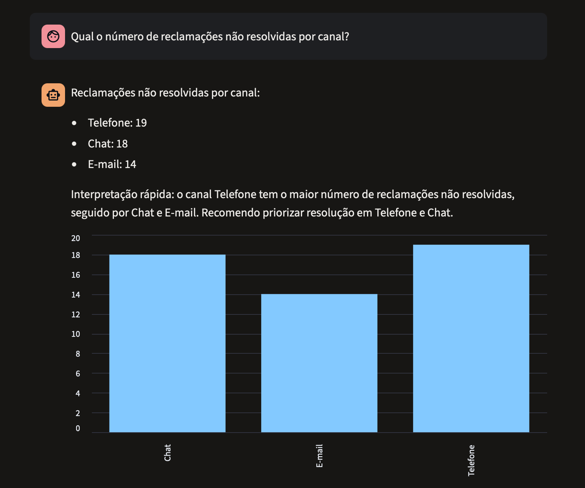

# Franq SQL Agent

A "virtual data analyst": ask a business question in Portuguese, and an LLM agent
explores a SQLite database with SQL, answers in text and shows the data as a table,
bar chart, line chart or single number. Built for the Franq hiring challenge
(Desafio Técnico 1) with LangGraph, OpenAI and Streamlit.

The database (`anexo_desafio_1.db`, from the challenge) has four tables: `clientes`,
`compras`, `suporte` and `campanhas_marketing`. Its data spans 2024-07-22 to 2025-07-22.

**Language.** The agent works in Portuguese: users ask in Portuguese, and the system
prompt, tool descriptions, UI and answers are in Portuguese, matching the users and the
data values (`'Reclamação'`, `'Telefone'`). Code, docs and commits are in English.

## How to run

Requirements: an OpenAI API key and the challenge database file.

Put the challenge database at `data/anexo_desafio_1.db` (it is not in git), then:

```bash
cp .env.example .env          # then set OPENAI_API_KEY in .env
# optional: LLM_MODEL in .env (default: gpt-5-mini)
```

### With uv (recommended)

[uv](https://docs.astral.sh/uv/) installs Python 3.11 if needed and the exact versions in
`uv.lock`:

```bash
uv sync
uv run streamlit run app.py   # chat UI; the sidebar has the 5 example questions
uv run pytest                 # tests; the ones needing the database skip if it is missing
uv run ruff check .           # lint
```

### With pip

Needs Python 3.11 installed. `requirements.txt` pins the direct dependencies only.

```bash
python3.11 -m venv .venv
source .venv/bin/activate
pip install -r requirements.txt
streamlit run app.py
pytest
ruff check .
```

## Agent flow and architecture

```
START --> agent <---> tools
            |
            +--> END
```

- `agent`: the LLM (with two tools bound) reads the conversation and either calls
  `run_sql`, or calls `final_answer`. Tools are bound with `tool_choice="required"`
  and `parallel_tool_calls=False`, so every turn is exactly one tool call.
- `tools`: runs the `run_sql` query against the database and sends the result (or the
  error message) back to the agent, which can then correct its SQL.
- The graph ends when the agent calls `final_answer` (text, final SQL, chart type,
  x/y columns and an optional `serie` column), or when the turn limit is reached.

Code layout:

| File | Role |
| --- | --- |
| `src/schema.py` | Reads the schema, value lists for low-cardinality columns and date ranges |
| `src/prompts.py` | Builds the system prompt (in Portuguese) from the schema |
| `src/db.py` | Safe query execution (`run_query`) and CSV formatting for the LLM |
| `src/agent.py` | The LangGraph agent and `ask()` |
| `src/viz.py` | Validates the LLM's chart choice against the real data |
| `src/llm.py` | OpenAI model factory (`OPENAI_API_KEY`, `LLM_MODEL`) |
| `app.py` | Streamlit chat interface |
| `src/evaluation.py` | Compares the agent's final data with a reference result |
| `scripts/run_examples.py` | Runs the 5 example questions and compares with reference SQL |

## Design decisions

- **Read-only database access.** Queries run on a connection opened with the SQLite URI
  `mode=ro`, with an authorizer that only allows the `SELECT`, `READ`, `FUNCTION` and
  `RECURSIVE` (for `WITH RECURSIVE`) actions, and a check that only a single statement
  is sent. The LLM cannot change the data.
- **Bounded queries.** Each query is interrupted after 10 s (an SQLite progress
  handler checks a deadline) and at most 10,000 rows are fetched. A timeout comes back
  to the LLM as an error asking for a simpler query; when the row cap is hit, the text
  sent to the LLM says the result was truncated. This applies both to the agent's
  queries and to the re-execution of the final SQL.
- **Table and chart data come from code; the answer text comes from the LLM.** The
  agent returns the final SQL; the code re-executes it and draws the table or chart from
  that result, so the data on screen is never copied from LLM text. The answer text
  (including any numbers written in it) is written by the LLM.
- **Relative periods use the data, not today's date.** The prompt tells the model the
  data's last date and that "last year" or "last 3 months" count backwards from it
  (for example `date('2025-07-22', '-1 year')`). It also names the partial first and
  last months (computed from the data range) so a short month is not read as a trend.
- **Business rules in the prompt.** "Average per customer" in a category means
  purchases divided by distinct buyers of that category; "complaint" means a support
  contact of type `Reclamação`, not every support contact; a top-N cut that falls inside
  a tie must be reported with every tied item, and the final SQL returns only the top N
  plus the tied rows; the answer text uses business language, not column names or SQL
  (the SQL is shown under "Como cheguei aqui").
- **Personal data is blocked by the database.** The schema given to the LLM lists only
  column names, types, categories and date ranges; `clientes.nome` and `clientes.email`
  are never sampled. On top of that, the SQLite authorizer denies reading those two
  columns, so no query can return them (`SELECT *` on `clientes` fails with a message
  asking the LLM to list the columns it needs). This holds whatever the prompt says or
  the user asks. Other query results (up to 200 rows, as CSV) are still sent to the LLM.
- **Bounded loops with a polite fallback.** The agent is limited to 8 turns and the
  graph has a recursion limit as a safety net. Each OpenAI request has a 60 s timeout
  and up to 2 retries. If it cannot finish, the user gets
  "Não consegui concluir a análise." plus the last SQL error, if any.
- **Chart choice is validated.** The LLM may request a bar or line chart, but
  `src/viz.py` checks it against the data (x and y exist and differ, y is numeric,
  more than one row) and falls back to a table otherwise. A 1x1 result is shown as a
  number.
- **Multi-series charts.** For trends or comparisons per category (for example
  complaints per month and per channel), the LLM returns long-format data and names the
  category column in `serie`; the app pivots it into one line or bar per category. If
  `serie` is missing but x repeats, `src/viz.py` uses the only other non-numeric
  column; if there is none (or more than one), it shows a table instead of a zigzag
  line. Bar charts keep the row order of the final SQL (so a ranking stays a ranking);
  line charts are sorted by x.
- **The model must always call a tool.** Without `tool_choice="required"` a model can
  stop mid-investigation with plain text and no data. A plain-text reply is still
  handled (shown as text) as a safety net. `gpt-5-mini` accepted these settings in eval
  round 1; a model or provider that does not support `tool_choice` or
  `parallel_tool_calls` would reject the request.

## Tested examples

The 5 questions below are the example questions from the challenge (they are also in
the app's sidebar). Each has a hand-written reference SQL in `scripts/run_examples.py`.

### Reference results

Computed by running the reference queries with
`python scripts/run_examples.py --reference-only`. They are what the agent should
answer, not the agent's own outputs.

Interpretation choices: "em maio" means May 2025 (the only May in the data), "no último
ano" means 2025-07-22 minus one year up to 2025-07-22, "reclamações" means
`suporte.tipo_contato = 'Reclamação'`, and boolean columns are 0/1.

1. **Liste os 5 estados com maior número de clientes que compraram via app em maio.**
   Distinct customers per state with an `App` purchase in May:
   São Paulo 6, Minas Gerais 3, Santa Catarina 3, then a three-way tie at 2 (Alagoas,
   Espírito Santo, Paraná). The reference lists all three tied states; an answer is
   correct if it has the first three states and at least two of the tied ones.
2. **Quantos clientes interagiram com campanhas de WhatsApp em 2024?**
   17 distinct customers (`interagiu = 1`, channel WhatsApp, `data_envio` in 2024).
3. **Quais categorias de produto tiveram o maior número de compras em média por cliente?**
   Purchases divided by distinct buyers per category: Roupas 2.211, Viagens 2.162,
   Livros 1.976, Serviços 1.962, Eletrônicos 1.923, Alimentos 1.882.
4. **Qual o número de reclamações não resolvidas por canal?**
   Telefone 19, Chat 18, E-mail 14.
5. **Qual a tendência de reclamações por canal no último ano?**
   Monthly complaints per channel, 2024-07 to 2025-07 (38 rows, in the script output).
   For example, Telefone peaks at 6 in 2024-10 and Chat at 6 in 2025-02. 2024-07 and
   2025-07 are partial months.

### Eval round 1 (gpt-5-mini, 2026-11-17)

First run of the agent with a real OpenAI key, asking the 5 questions in the Streamlit
app. This round used the code before the fixes listed below.

| # | Question (short) | Data vs reference | Finding |
| --- | --- | --- | --- |
| 1 | Top 5 states, App purchases in May | Match | 5th place is a tie; the agent picked two of the three tied states without saying so |
| 2 | WhatsApp campaign interactions in 2024 | Match (17) | Answer text used column names (`cliente_id`, `interagiu = 1`) |
| 3 | Purchases on average per customer, by category | **Different** | Divided by all 100 customers instead of the buyers of each category; it stated the assumption and offered the alternative |
| 4 | Unresolved complaints per channel | Match (19 / 18 / 14) | None |
| 5 | Complaint trend per channel, last year | Match | Read the drop in 2025-07 (data ends on the 22nd) as a real trend |

Other findings: bar charts were drawn in alphabetical order, so rankings (Q1, Q4) lost
their order; and Q3 was not consistent: in a scripted run
(`python scripts/run_examples.py`, saved in
[`docs/examples-round-1.md`](docs/examples-round-1.md)) the
agent computed both definitions and its data matched the reference, while in the app it
gave only the "all customers" one.

Screenshots of round 1 in the app:

| Q1 | Q2 | Q3 (text) |
| --- | --- | --- |
|  |  |  |

| Q4 | Q5 (text) | Q5 (chart) |
| --- | --- | --- |
|  |  |  |

Fixes made after round 1 (each change in `src/` and `app.py` has a test):

- Prompt: definition of "average per customer" (Q3), partial first and last months (Q5),
  ties at a top-N cut (Q1), business language in the answer text (Q2).
- Bar charts keep the row order of the final SQL.
- The database denies reading `clientes.nome` and `clientes.email`.
- `scripts/run_examples.py --repeat [N]` runs each question N times (3 by default) and
  reports how many runs matched the reference data, to measure consistency. The match
  ignores the agent's column names and compares numbers at 2 decimals. For Q1 the
  states above the tie are required and any of the tied states can fill 5th place. A
  run that raises an error counts as not matching, and the other runs go on.

### Eval rounds 2 and 3 (gpt-5-mini, 2026-11-17)

Scripted runs with `python scripts/run_examples.py --repeat` (each question 3 times),
checked automatically against the reference data. Round 2 used the fixes above; round 3
added two more prompt fixes based on round 2.

| # | Question (short) | Round 1 (1 run, checked by hand) | Round 2 | Round 3 |
| --- | --- | --- | --- | --- |
| 1 | Top 5 states, App purchases in May | Match (tie hidden) | 1/3 | **3/3** |
| 2 | WhatsApp campaign interactions in 2024 | Match | 3/3 | **3/3** |
| 3 | Purchases on average per customer, by category | Different | 3/3 | **2/3** |
| 4 | Unresolved complaints per channel | Match | 2/3 | **3/3** |
| 5 | Complaint trend per channel, last year | Match | 3/3 | **3/3** |

Full outputs: [round 2](docs/examples-round-2.md), [round 3](docs/examples-round-3.md).

Round 2 findings and the fixes made for round 3:

- **Q1 (1/3).** All 3 answer texts were right and named the tie, but the data matched in
  only 1 run. In run 1 (the run whose SQL is saved) the final SQL was the exploratory
  query without `LIMIT`, so the table showed all 15 states; the tie rule had suggested
  querying without `LIMIT` to check for ties. Fix: the prompt
  separates exploring from the final query and gives a cut-off query template; the
  `final_answer` tool asks for exactly the answer's rows.
- **Q4 (2/3).** One run counted every unresolved support contact (138) instead of
  unresolved complaints (51). Fix: the prompt defines a complaint as a contact of type
  `Reclamação`.

Round 3 notes:

- **Q3 (2/3).** The run that did not match answered only the top category (Roupas, 2.211
  purchases per customer, with the right definition); the check expects all 6
  categories. The question ("Quais categorias...") allows both readings. The check was
  not relaxed after seeing the result.
- **Business language.** Some answer texts still used column names or SQL: 3 of 15 in
  round 2 (one pasted its whole SQL) and 3 of 15 in round 3 (`interagiu = 1`,
  `tipo_contato = 'Reclamação'`, `tipo = 'Reclamação'`). Two of the round 3 cases echo
  the complaint rule, which was written as SQL in the prompt.

Changes after round 3, from code review, **not yet measured by an eval run**: the
complaint rule is now written in words, and the top-N template uses `RANK()` instead of
an `OFFSET` cut-off (the `OFFSET` version returned no rows when a list had fewer than N
items, for example a top 5 of the 3 support channels).

### How to rerun

`python scripts/run_examples.py --repeat` (needs `OPENAI_API_KEY`) runs the agent on the
5 questions 3 times each and writes `docs/examples.md` (the latest run; each round above
is kept in its own file): a summary of matching runs per
question, then, for each question, the final text, the requested visualization, every
SQL step with its row count, the final SQL and data, and the reference SQL and result
side by side.

## Known risks and what production would need

This is a prototype for the challenge. Before real use it would need:

- **Data sent to a third party (LGPD).** Query results (up to 200 rows per query) go to
  OpenAI. Names and e-mails are blocked, but customer ids, states and purchase history
  still leave the company. Production needs a legal basis and a data processing
  agreement, or a model hosted in-house.
- **No authentication or rate limit.** Anyone who can open the app can ask unlimited
  questions on the company's API key (cost abuse). Production needs login and per-user
  limits.
- **Raw error text in the UI.** An unexpected exception is shown as
  `Erro ao processar a pergunta: <exception text>`, which can reveal internals. It
  should be logged and replaced by a generic message.
- **Large values are not bounded.** The 10 s deadline and the 10,000-row cap do not
  limit the size of a single value: `SELECT randomblob(100000000)` returned one 100 MB
  cell in 0.6 s. A query like that uses memory and would be sent to the LLM as text.
  Production needs a byte limit on results (or denying functions such as `randomblob`
  and `zeroblob`).

## Possible improvements

- **Async API.** Expose the agent behind an API (for example FastAPI with a job id, or
  server-sent events streaming each SQL step), so the UI does not wait on one request.
- **Automated evaluation in CI.** Grow the 5 reference queries into a larger set and
  run `run_examples.py --repeat` on a schedule, failing when the match rate drops.
- **Cache the schema.** The schema is read from the database on every question; compute
  it once per process.
- **Stream the steps in the UI.** Show each SQL query as the agent runs it, instead of
  a spinner followed by an expander.
- **Few-shot examples.** Add a few question/SQL pairs to the prompt for tricky cases.
- **Cost and latency tracking.** Record tokens, number of turns and time per question.
- **Ask instead of assuming.** For ambiguous questions (for example two reasonable
  definitions of an average), ask the user a clarifying question.
