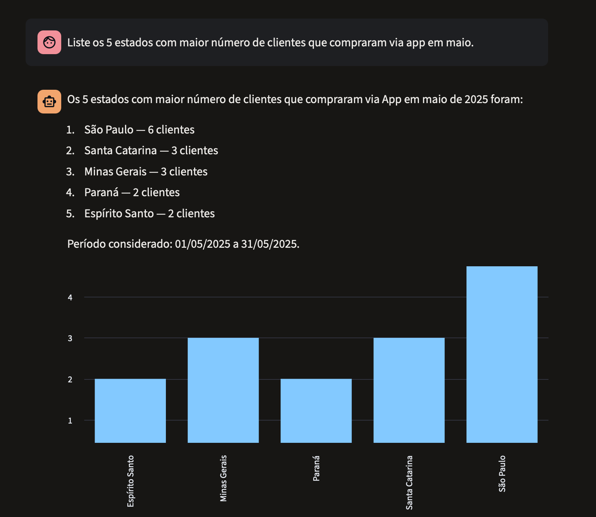
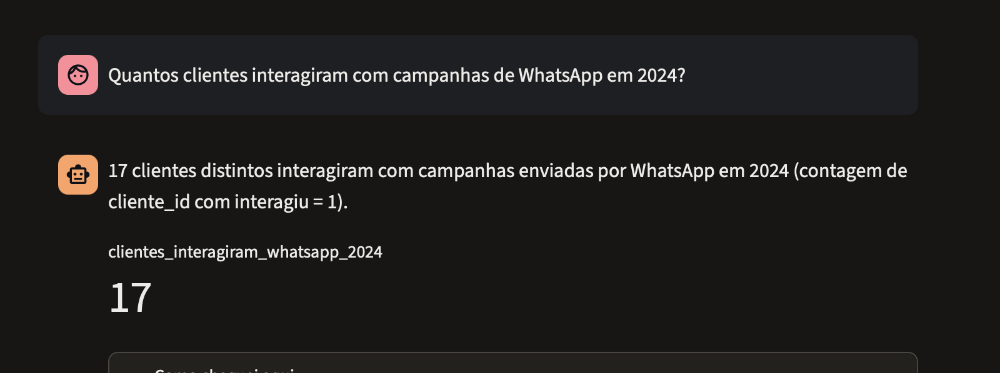
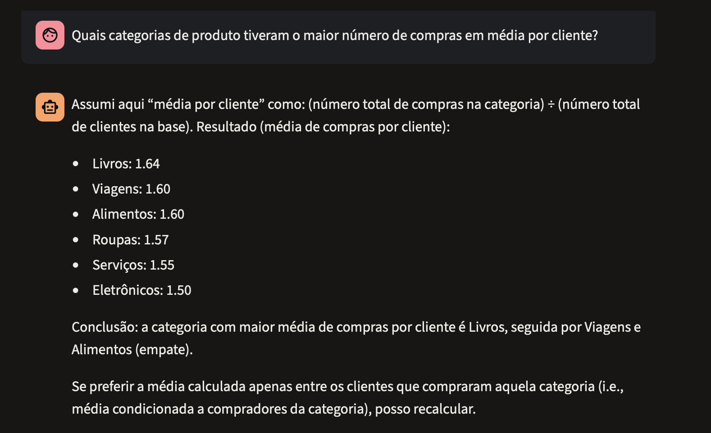
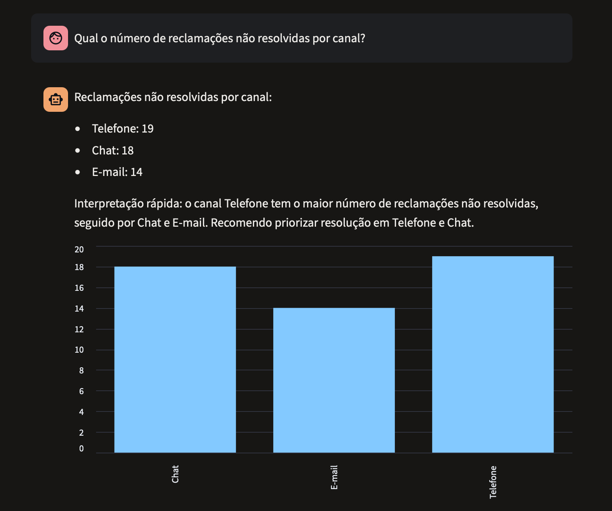
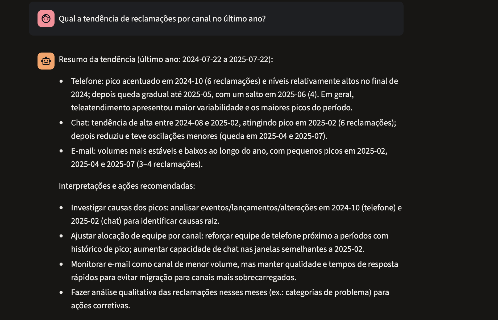
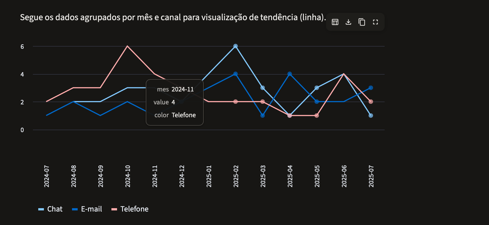

# Evaluation history

How the agent was measured and what changed between rounds. The summary is in the
[README](../README.md#tested-examples).

## Method

The 5 questions are the example questions from the challenge. Each has a hand-written
reference SQL in `scripts/run_examples.py`. `python scripts/run_examples.py --repeat`
runs the agent on each question 3 times and checks each run's final data against the
reference automatically (`src/evaluation.py`): the agent's column names are ignored,
numbers are compared at 2 decimals, and for Q1 the states above the tie are required
while any of the tied states can fill 5th place. A run that raises an error counts as
not matching.

Interpretation choices: "em maio" means May 2025 (the only May in the data), "no último
ano" means 2025-07-22 minus one year up to 2025-07-22, "reclamações" means support
contacts of type `Reclamação`, and boolean columns are 0/1.

Reference results (`python scripts/run_examples.py --reference-only`):

1. **Liste os 5 estados com maior número de clientes que compraram via app em maio.**
   São Paulo 6, Minas Gerais 3, Santa Catarina 3, then a three-way tie at 2 (Alagoas,
   Espírito Santo, Paraná). The reference lists all three tied states.
2. **Quantos clientes interagiram com campanhas de WhatsApp em 2024?** 17.
3. **Quais categorias de produto tiveram o maior número de compras em média por cliente?**
   Purchases divided by distinct buyers per category: Roupas 2.211, Viagens 2.162,
   Livros 1.976, Serviços 1.962, Eletrônicos 1.923, Alimentos 1.882.
4. **Qual o número de reclamações não resolvidas por canal?** Telefone 19, Chat 18,
   E-mail 14.
5. **Qual a tendência de reclamações por canal no último ano?** Monthly complaints per
   channel, 2024-07 to 2025-07 (38 rows). Telefone peaks at 6 in 2024-10 and Chat at 6
   in 2025-02. 2024-07 and 2025-07 are partial months.

All rounds used `gpt-5-mini` on 2026-11-17.

| # | Question (short) | Round 1 (1 run, checked by hand) | Round 2 | Round 3 | Round 4 |
| --- | --- | --- | --- | --- | --- |
| 1 | Top 5 states, App purchases in May | Match (tie hidden) | 1/3 | 3/3 | 3/3 |
| 2 | WhatsApp campaign interactions in 2024 | Match | 3/3 | 3/3 | 3/3 |
| 3 | Purchases on average per customer, by category | Different | 3/3 | 2/3 | 3/3 |
| 4 | Unresolved complaints per channel | Match | 2/3 | 3/3 | 3/3 |
| 5 | Complaint trend per channel, last year | Match | 3/3 | 3/3 | 3/3 |
| | Answer texts with column names or SQL | | 3/15 | 3/15 | 4/15 |

Full outputs: [round 1](examples-round-1.md), [round 2](examples-round-2.md),
[round 3](examples-round-3.md), [round 4](examples-round-4.md).

## Round 1

First run with a real OpenAI key, asking the 5 questions in the Streamlit app.

| # | Finding |
| --- | --- |
| 1 | 5th place is a tie; the agent picked two of the three tied states without saying so |
| 2 | Answer text used column names (`cliente_id`, `interagiu = 1`) |
| 3 | **Different data**: divided by all 100 customers instead of the buyers of each category; it stated the assumption and offered the alternative |
| 4 | None |
| 5 | Read the drop in 2025-07 (data ends on the 22nd) as a real trend |

Also: bar charts were drawn in alphabetical order, so rankings lost their order; and Q3
was not consistent: in a scripted run the agent computed both definitions and its data
matched, while in the app it gave only the "all customers" one.

Screenshots (round 1 code):

| Q1 | Q2 | Q3 (text) |
| --- | --- | --- |
|  |  |  |

| Q4 | Q5 (text) | Q5 (chart) |
| --- | --- | --- |
|  |  |  |

Fixes for round 2 (each with a test): prompt rules for "average per customer" (Q3),
partial first and last months (Q5), ties at a top-N cut (Q1) and business language
(Q2); bar charts keep the SQL row order; the database denies reading `clientes.nome`
and `clientes.email`; `run_examples.py --repeat` and the automatic check.

## Round 2

- **Q1 (1/3).** All 3 answer texts were right and named the tie, but the data matched in
  only 1 run. In run 1 (the run whose SQL is saved) the final SQL was the exploratory
  query without `LIMIT`, so the table showed all 15 states; the tie rule had suggested
  querying without `LIMIT` to check for ties.
- **Q4 (2/3).** One run counted every unresolved support contact (138) instead of
  unresolved complaints (51).

Fixes for round 3: the prompt separates exploring from the final query and gives a
cut-off query template, and the `final_answer` tool asks for exactly the answer's rows;
the prompt defines a complaint.

## Round 3

- **Q3 (2/3).** The run that did not match answered only the top category (Roupas, 2.211,
  with the right definition); the check expects all 6 categories. The question ("Quais
  categorias...") allows both readings. The check was not relaxed after seeing the
  result.
- **Business language: 3 of 15 texts** used column names or SQL; two of them echoed the
  complaint rule, which was written as SQL in the prompt.

Fixes for round 4, from code review: the complaint rule is written in words, and the
top-N template uses `RANK()` instead of an `OFFSET` cut-off (the `OFFSET` version
returned no rows when a list had fewer than N items, for example a top 5 of the 3
support channels).

## Round 4

- **Data: 15 of 15 runs matched the reference.** Two caveats: 3 runs per question is a
  small sample, and these are the same 5 questions the prompt rules were tuned on, so
  this does not show how the agent does on new questions.
- **Business language is still not solved: 4 of 15 texts.** They no longer echo the
  complaint rule, but still write `interagiu = 1` (Q2, twice) or `resolvido = 0` (Q4),
  and one Q5 answer pasted its SQL. Four other answers end by announcing a SQL query that
  they do not show. A prompt rule alone does not hold this; a check in code on the
  answer text would.

## How to rerun

`python scripts/run_examples.py --repeat` (needs `OPENAI_API_KEY`) writes
`docs/examples.md`: a summary of matching runs per question, then, for each question,
the final text, the requested visualization, every SQL step with its row count, the
final SQL and data, and the reference SQL and result side by side.
